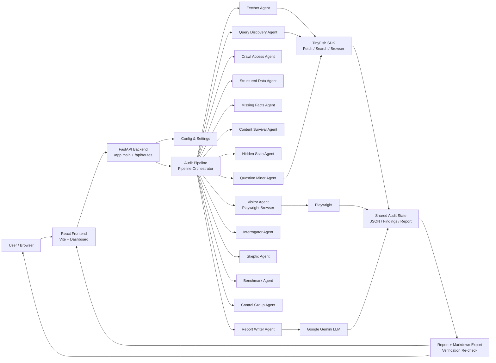

# TinyFish — AI Readability & Visibility Auditor

A lightweight AI-SEO and content-visibility auditing tool that answers a simple but increasingly important question:

"Can AI tools and answer engines actually read and understand this page the way a human visitor does?"

This project audits a public URL across browser-rendered content, AI fetch extraction, search visibility, answerability, crawl access, and structured metadata. It runs a multi-agent analysis and produces an evidence-backed report with concrete fixes.

## Why this project exists

Modern SEO is no longer only about ranking for humans. Pages are read by:

- classic search crawlers
- AI agents and assistants
- answer engines and summarizers
- browser-based evaluation systems
- retrieval pipelines that rely on visible text, not just HTML source

If key facts are hidden behind JavaScript, collapsed sections, images, PDFs, bot blocks, or missing structured metadata, a page can look fine to users while being effectively invisible to AI systems.

TinyFish is designed to surface those gaps before they cost visibility, conversions, or share of voice.

## What the app builds

The project is a full-stack auditing app with:

- a Python FastAPI backend
- a React + Vite frontend dashboard
- a multi-agent analysis pipeline
- a markdown exportable report
- a verification flow to re-check fixes after updates

It does not just run a crawler. It compares multiple views of the page:

1. What a real browser renders
2. What an AI fetcher can extract
3. What users can read
4. What the page is actually missing from search/answer contexts
5. Whether AI crawlers are blocked or under-informed

## Core capabilities

### Browser vs AI extraction diff
The app loads a page in a browser, expands tabs/accordions, and extracts human-visible text. It then compares this to the text returned by TinyFish Fetch. This highlights content that is effectively lost to AI tools.

### Fact-level gap detection
The Missing-Facts agent labels facts humans can see but AI tools cannot. It classifies the likely cause such as:

- JavaScript-injected content
- collapsed or hidden accordion/tab content
- content trapped in images or PDFs
- page-level bot or access blocks

### Crawl access and AI readability checks
The project inspects:

- robots.txt and crawler rules
- sitemap signals
- llms.txt presence
- AI crawlers such as GPTBot and other bot agents
- whether the page is restricted or unreadable to fetch pipelines

### Query discovery and competitive benchmark
The app identifies the queries relevant to the page, checks this page's position, and compares it to rival pages that rank higher. It then benchmarks common SEO/answer-surface features such as pricing, FAQ sections, review proof, comparison tables, and structured content.

### Question mining and interrogator checks
The system mines questions that competitors answer and tests whether the target page can answer the same buyer or informational questions with evidence from its own content.

### Skeptic and verification
The Skeptic stage challenges findings and tries to reject weak or unsupported conclusions. The final verification endpoint re-runs the page check after a fix is applied to see which issues have closed and which still remain.

## How the audit works

A single audit runs a pipeline of specialist agents.

- Fetcher: fetches the page as an AI tool would read it
- Visitor: loads the page in a browser and captures the rendered text
- Crawl Access: inspects bot access and AI-crawler posture
- Structured Data: checks JSON-LD and Open Graph signals
- Missing-Facts: compares browser-visible text against fetchable text
- Content Survival: identifies page elements that do not survive extraction
- Hidden Scan: flags hidden or instruction-like text patterns
- Query Discovery: gathers relevant search queries and positions
- Question Miner: extracts subject questions from outranking pages
- Interrogator: answers those questions using the target page only
- Skeptic: filters low-confidence findings
- Benchmark: compares the page against stronger rivals
- Control Group: validates the coverage of the rival set
- Report Writer: assembles the verdict and prioritized fixes

The app then exposes the result in the dashboard and as Markdown via an API route.

## Tech stack

### Backend
- Python
- FastAPI
- Pydantic + Pydantic Settings
- TinyFish SDK for fetch/search/browser capabilities
- Google Gemini for structured reasoning and JSON extraction
- Playwright for browser rendering and DOM inspection
- pytest for tests

### Frontend
- React 19
- Vite
- Plain CSS for the dashboard and landing page

## Architecture



## Project structure

```text
tinyfish/
├── README.md
├── backend/
│   ├── .env.example
│   ├── requirements.txt
│   ├── pytest.ini
│   ├── app/
│   │   ├── __init__.py
│   │   ├── main.py
│   │   ├── agents/
│   │   │   ├── benchmark.py
│   │   │   ├── content_survival.py
│   │   │   ├── crawl_access.py
│   │   │   ├── fetcher.py
│   │   │   ├── hidden_scan.py
│   │   │   ├── interrogator.py
│   │   │   ├── missing_facts.py
│   │   │   ├── query_discovery.py
│   │   │   ├── question_miner.py
│   │   │   ├── report_writer.py
│   │   │   ├── skeptic.py
│   │   │   ├── structured_data.py
│   │   │   └── visitor.py
│   │   ├── api/
│   │   │   └── routes.py
│   │   ├── core/
│   │   │   └── config.py
│   │   ├── schemas/
│   │   │   ├── api.py
│   │   │   └── state.py
│   │   └── services/
│   │       ├── http.py
│   │       ├── llm.py
│   │       ├── pipeline.py
│   │       ├── text.py
│   │       ├── tinyfish.py
│   │       └── verify.py
│   └── tests/
│       ├── test_fallbacks.py
│       └── test_text.py
├── frontend/
│   ├── index.html
│   ├── package.json
│   ├── vite.config.js
│   └── src/
│       ├── App.jsx
│       ├── api.js
│       ├── emptyJob.js
│       ├── main.jsx
│       ├── recent.js
│       ├── styles.css
│       └── components/
│           ├── Evidence.jsx
│           ├── Findings.jsx
│           ├── Landing.jsx
│           ├── Overview.jsx
│           ├── TopBar.jsx
│           └── cards/
│               ├── AgentsStrip.jsx
│               ├── AnswerCard.jsx
│               ├── BenchmarkCard.jsx
│               ├── CrawlCard.jsx
│               ├── FixesCard.jsx
│               ├── RecentCard.jsx
│               ├── StatTiles.jsx
│               ├── SurvivalCard.jsx
│               └── VerifyCard.jsx
├── reports/
│   └── flipkart-fashion.md
└── ...
```

## Running locally

### 1) Configure backend environment

From the `backend` folder, create a `.env` file from `.env.example` and fill in the required keys:

```env
TINYFISH_API_KEY=your_tinyfish_key
GEMINI_API_KEY=your_gemini_key
# LLM_MODEL=gemini-flash-latest
```

### 2) Install backend dependencies

```powershell
cd tinyfish/backend
python -m pip install -r requirements.txt
python -m playwright install chromium
```

### 3) Start the API

```powershell
python -m uvicorn app.main:app --reload
```

The API will run at:

- http://localhost:8000
- docs: http://localhost:8000/docs

### 4) Start the frontend

```powershell
cd ../frontend
npm install
npm run dev
```

Open:

- http://localhost:5173

## API surface

The app exposes a simple job-based API.

### Create audit

```http
POST /api/audits
```

Request body:

```json
{
  "url": "https://example.com/product-page",
  "target_query": "best wireless headphones"
}
```

Response:

```json
{
  "id": "abc123",
  "status": "queued",
  "agents": [],
  "state": {
    "url": "https://example.com/product-page",
    "target_query": "best wireless headphones"
  }
}
```

### Get audit status

```http
GET /api/audits/{job_id}
```

### Download report as Markdown

```http
GET /api/audits/{job_id}/report.md
```

### Verify fixes after changes

```http
POST /api/audits/{job_id}/verify
```

This re-runs a fresh check and compares before-after readability and missing facts.

## Example output

The project includes a sample report in `reports/flipkart-fashion.md`, which demonstrates the real output generated by the app. It includes sections such as:

- What AI can't read
- What AI can't answer
- Crawl access
- Structured data
- Hidden text and injection
- Visibility and ranked queries
- Top fixes

This is a good example of the kind of diagnosis the tool is meant to produce.

## Intended use

This project is targeted at:

- SEO and content teams
- digital product owners
- marketing and growth teams
- AI optimization work
- teams managing public pages that must remain readable by both people and AI systems

It is especially useful for sites with:

- JavaScript-heavy storefronts
- tabbed or accordion-heavy content
- pages that rely on pricing, FAQs, or compliance info in hidden or dynamic sections
- weak structured data or poor AI crawl posture

## Notes

- Jobs are stored in memory and are not persisted across server restarts.
- The pipeline is designed to be resilient: if an LLM call fails, deterministic fallback logic still produces useful findings.
- Local Playwright fallback exists when remote browser proxies are unavailable.
- The project focuses on reporting and diagnosis, not on generating a full CMS or SEO platform backend.

## Summary

TinyFish is a practical AI-visibility audit tool for the modern search landscape. It lets teams answer the real question behind many SEO and content problems:

"Are humans seeing value, while AI systems are missing it?"

If a page is readable to users but invisible to AI tools, the result is often the same pattern: lost traffic, weaker answerability, lower trust, and fewer conversions. This project is built to make those losses visible and actionable.
